# Raga Tamagotchi

A virtual pet with mini games for the **Philips GoGear Raga** (SA3RGA, 2011),
a small MP3 player. It runs on the player's own chip, starts at power-on, and
the original music player is still one button away.

- Five pets to choose from: chick, cat, dog, dragon, bunny
- Four needs: fullness, happiness, cleanliness, energy; poops to clean up
- A clock and a night's sleep (21:00-09:00) paced like the 1997 Tamagotchi:
  a heart of hunger every ~75 minutes, a poop every ~3 hours, nothing drains
  at night
- Mini games that cheer the pet up: Flappy, Snake, Catch, Runner

| | |
|---|---|
| 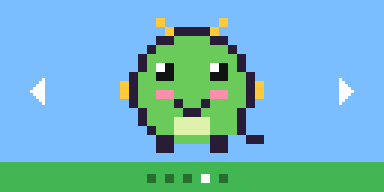 | 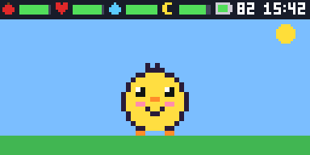 |
| 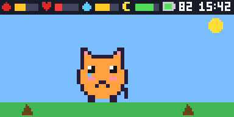 | 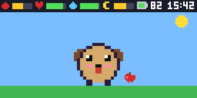 |
| 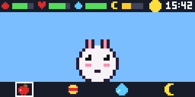 | 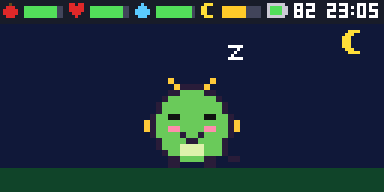 |
| 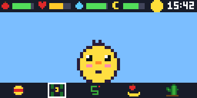 | 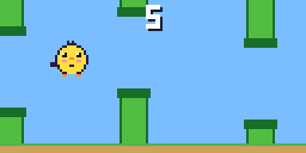 |
| 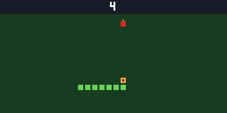 | 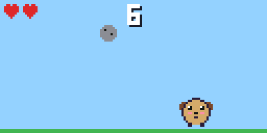 |
| 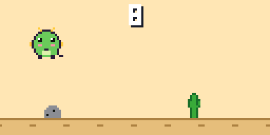 | |

The screen is 128x64; these are the game's own frames, drawn on a computer
by the same code (`make screenshots`) and scaled up 3x.

This repository has no Philips code. You dump the firmware from your own
Raga, the build adds the game to it, and you write the result back.

## Compatibility

Tested on **SA3RGA02PN/97** with Philips firmware **1.7.0**. The build checks
your dump against the known 1.7.0 image and stops on anything else. Other
Raga models (SA2RGA, SA4RGA) have different firmware and are not supported.

## What you need

- The Raga and its USB cable.
- macOS or Linux with `arm-none-eabi-gcc`, git, a C compiler, libusb-1.0 and
  pkg-config. `make tools` fetches Rockbox's sources and builds the rest
  into `tools/bin/` (not in the repository; it appears after that step),
  including `scsitool`, which reads and writes the player's firmware over USB.
- On Windows: build inside WSL, read and write from Windows (see below).

### Windows

The build needs a Unix shell, so it runs in WSL (Ubuntu). Talking to the Raga
from WSL would need USB passthrough, so reading and writing stay on the
Windows side with the prebuilt `scsitool` in `prebuilt/`.

    wsl --install -d Ubuntu

In Ubuntu:

    sudo apt install build-essential git pkg-config libusb-1.0-0-dev gcc-arm-none-eabi

Clone the project inside WSL and follow the steps below, running
`make tools` and `make` in Ubuntu and every `scsitool` command in an
administrator prompt on Windows (`prebuilt\scsitool-x86_64.exe`, with `E:`
as the device). Windows sees the WSL files under `\\wsl$\Ubuntu\`, so the
dump goes into the project's `firmware\` folder there, and the image to
write is in its `build\` folder.

## Install

`scsitool` talks to the Raga in its normal USB mode: switch the player off,
then plug it in. Below, `<dev>` is how to name the device:

| System | `<dev>` | Notes |
|---|---|---|
| macOS | `-` | run with `sudo`; first `diskutil unmount "/Volumes/NO NAME"` |
| Linux | `/dev/sgN` | the Raga's SCSI generic node (`lsscsi -g`), with `sudo` |
| Windows | `E:` | its drive letter, administrator prompt, `scsitool-x86_64.exe` (`-aarch64` on ARM) |

1. Build the tools into `tools/bin/`, then check the player:

       make tools
       sudo tools/bin/scsitool -i <dev>

   It must report `Chip Major Rev ID: 37b0` and, under `Drive 50`,
   `Project version: 1.7.0`.
2. Dump the firmware into the project. This is also your backup: keep a copy
   somewhere safe.

       sudo tools/bin/scsitool -x firmware/raga-stock.sb <dev>

3. Build:

       make

   This gives `build/raga-tama-fw.sb`.
4. Write it to the Raga:

       sudo tools/bin/scsitool -w build/raga-tama-fw.sb --yes-i-want-a-brick <dev>

5. Optional, recommended: read it back; the two checksums must match.

       sudo tools/bin/scsitool -x build/readback.sb <dev>
       shasum build/readback.sb build/raga-tama-fw.sb

6. Unplug, then switch on with the power slider.

## Playing

| Button | Pet screen | Games |
|---|---|---|
| MENU | open actions: feed / play / clean / nap | |
| LEFT, RIGHT | choose | move (Snake, Catch) |
| PLAY | confirm; pet the pet | flap / jump / start |
| UP, DOWN | | Snake; UP also flaps and jumps |
| BACK | close menu | leave the game |

- At power-on: pick a pet (LEFT/RIGHT, PLAY), then set the clock
  (UP/DOWN change, LEFT/RIGHT hours/minutes, PLAY).
- The screen turns off after a minute; any button wakes it.
- Hold the power slider for 2 seconds to switch off.
- Hold **BACK** while switching on for the original music player.
- With USB connected at power-on the Raga starts in its normal USB mode
  (music transfer, charging).

The pet is not saved yet: switching off starts over with a new pet.

## Restore the original firmware

USB mode and the boot loader are untouched, so the Raga keeps showing up on
USB. Write your backup from Install step 2 the same way:

    sudo tools/bin/scsitool -w firmware/raga-stock.sb --yes-i-want-a-brick <dev>

If it does not boot at all, use the chip's USB recovery mode, which lives in
mask ROM and cannot be overwritten: switch off, hold UP (volume +) and plug
USB in; the device appears as `Sigmatel ROM Recovery` (`066f:3770`). Then
`sudo tools/bin/sbloader firmware/raga-stock.sb` starts the stock firmware
from USB, after which the write above works.

## Trying changes without flashing

The game can run from RAM over USB, leaving the device untouched: put the
Raga in recovery mode (above) and

    make run           # the Tamagotchi
    make run-keytest   # raw button values, for calibration

Unplugging USB reboots into whatever is in flash.

## How it works

The SA3RGA is built on a SigmaTel/Freescale STMP3770 with a 128x64 colour
TFT. Philips' firmware is an `.sb` image encrypted with the all-zero key, so
Rockbox's tools unpack and repack it. The build unpacks your dump into
`build/fw/` and inserts the game into the player section right after
Philips' first stage (`play0`), which has already set up power, clocks and
the LCD; the game reuses its LCD command routine and drives the rest of the
hardware directly. Every other section is left as it was. Details:
[docs/HARDWARE.md](docs/HARDWARE.md).

## Contents

| Path | |
|---|---|
| `src/` | the game (C, bare metal ARM926) |
| `firmware/*.db` | elftosb recipes: installable image, RAM images |
| `firmware/raga-stock.sb` | your dump goes here (not in git) |
| `prebuilt/` | Windows `scsitool` builds |
| `tools/build-tools.sh` | builds the Rockbox tools (pinned commit) into `tools/bin/` (`make tools`; not in git) |
| `tools/rbscsi-libusb.c` | lets `scsitool` run on macOS: USB mass storage commands over libusb |

## Credits and licences

- This project's own code (`src/`, `tools/rbscsi-libusb.c`, the build files
  and docs): MIT, see [LICENSE](LICENSE).
- Rockbox `imxtools` (sbtoelf, elftosb, sbloader, scsitool): GPLv2,
  <https://www.rockbox.org>. The `.exe` files in `prebuilt/` are built from
  the commit pinned in `tools/build-tools.sh`.
- The Philips firmware stays on your device and your machine; the images the
  build produces contain it and are for your own use.
- Pet timings follow community documentation of the original Tamagotchi P1
  (e.g. Thaao's P1 care guide).
